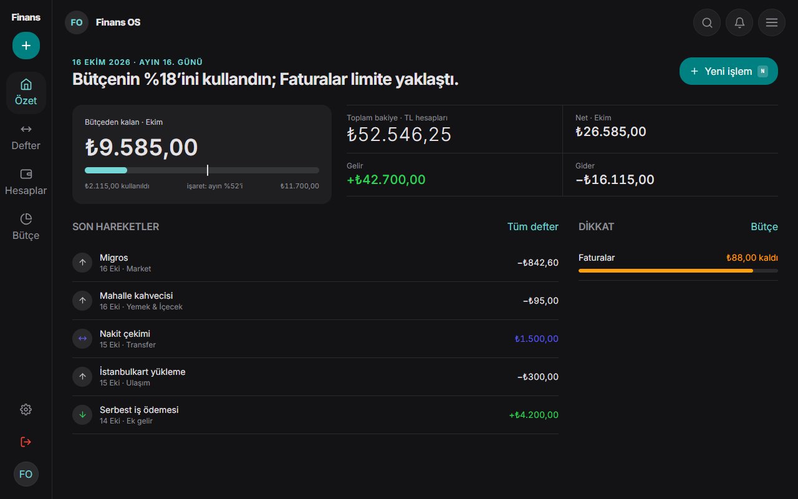
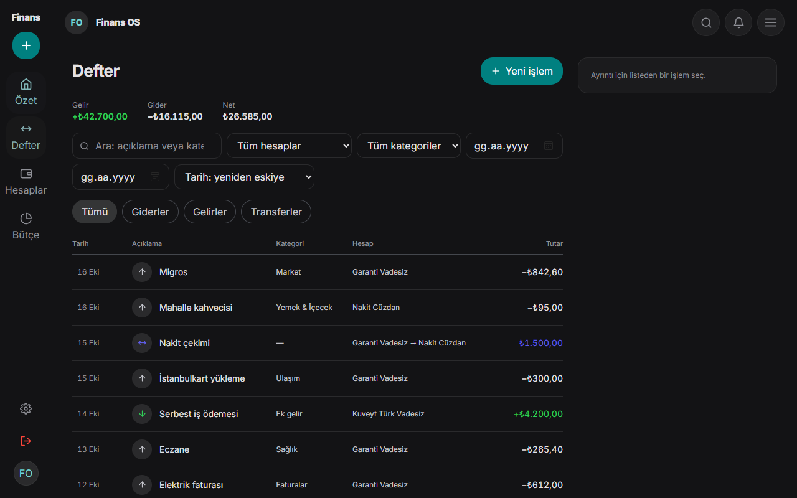
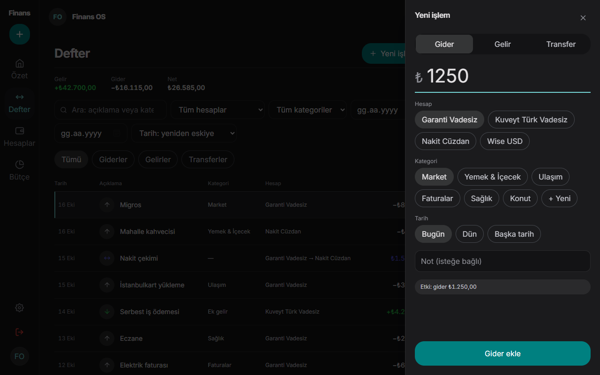
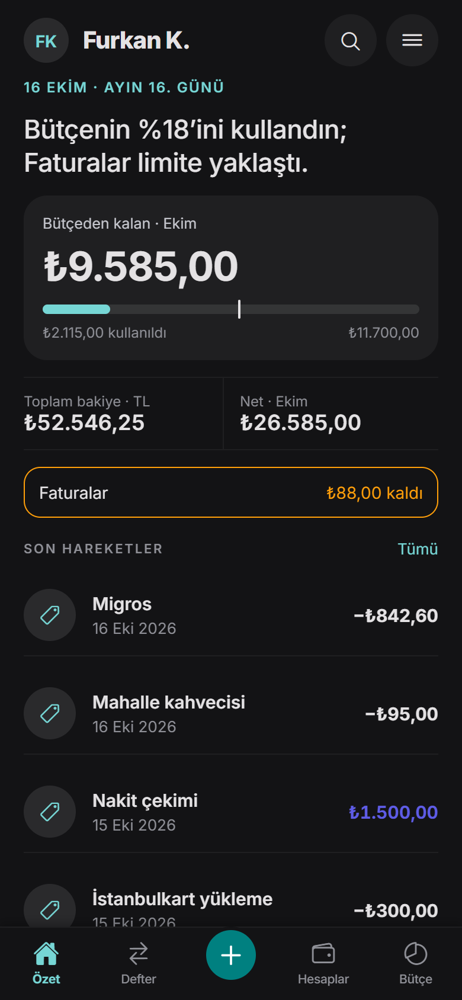

# Finans OS: Personal Finance OS

[Türkçe](#türkçe) · [English](#english)

---

## Türkçe

Baştan sona kendim geliştirdiğim bir kişisel finans sistemi: çift girişli defter (double-entry ledger) mantığıyla çalışan bir backend, bir web uygulaması ve bir mobil uygulama. Tüm tasarımın üstünde tek bir kural var: **para asla kayan noktalı sayıyla hesaplanmaz ve istemciler toplamları kendileri hesaplamaz.**

Kaynak kod özel (private) repolarda duruyor. Bu herkese açık repo vitrindir ve giriş noktasıdır; içinde uygulama kodu yoktur.

### Ekran görüntüleri

Gerçek arayüz, örnek veriyle çalışırken (gerçek hesap değil).

| Özet | Defter |
|---|---|
|  |  |

| Hızlı işlem | Mobil |
|---|---|
|  |  |

### Dört repo

| Repo | Görünürlük | Ne yapar |
|---|---|---|
| `personal-finance-backend` | özel | Alan motoru (kesin ondalık aritmetik, çift girişli defter), satır düzeyinde güvenlikli (RLS) PostgreSQL, REST API, OpenAPI sözleşmesi |
| `personal-finance-web` | özel | Next.js web istemcisi |
| `personal-finance-mobile` | özel | React Native / Expo istemcisi |
| `personal-finance-project-hub` | herkese açık | Bu repo |

```text
 Web (Next.js) ──┐
                 ├── REST / OpenAPI ──► Backend ──► PostgreSQL (RLS)
 Mobil (Expo)  ──┘
```

İstemciler yalnızca API ile konuşur. Backend'deki OpenAPI belgesi tek sözleşmedir; iki istemci de sabitlenmiş bir kopyasını tutar ve sözleşmeden sapma olursa CI kırılır.

### Nasıl geliştiriliyor

- **Önce finansal doğruluk.** Kesin ondalık aritmetik, çift girişli defter, tekrar güvenli (idempotent) yazmalar; düzenleme ve iptal bütçe ve raporları tutarlı bırakır.
- **Toplamlar için tek kaynak.** Toplamları backend hesaplar; web ve mobil sadece gösterir.
- **Seviye bazlı yayın.** Özellikler ürün seviyeleriyle çıkar, kullanıcı yalnızca bitmiş olanı görür.
- **Her repoda hızlı kalite kapısı** (lint, tip kontrolü, test, secret taraması): push öncesi ve CI'da çalışır.

### Bu repo hakkında

`npm run check`, hub'ın vitrin olarak kaldığını doğrular: uygulama kodu, SQL migration'ı veya secret dosyası yok. CI ayrıca tüm geçmişi Gitleaks ile tarar.

---

## English

A personal finance system I am building end to end: a double-entry ledger backend, a web app and a mobile app, with one rule above all the others: **money is never computed with floating point, and clients never calculate totals themselves.**

The source lives in private repositories. This public repo is the showcase and the entry point; it contains no application code.

### Screenshots

Real UI running against sample data (not real accounts).

| Overview | Ledger |
|---|---|
|  |  |

| Quick add | Mobile |
|---|---|
|  |  |

### The four repositories

| Repo | Visibility | What it is |
|---|---|---|
| `personal-finance-backend` | private | Domain engine (exact decimal arithmetic, double-entry ledger), PostgreSQL with row-level security, REST API, the OpenAPI contract |
| `personal-finance-web` | private | Next.js web client |
| `personal-finance-mobile` | private | React Native / Expo client |
| `personal-finance-project-hub` | public | This repo |

```text
 Web (Next.js) ──┐
                 ├── REST / OpenAPI ──► Backend ──► PostgreSQL (RLS)
 Mobile (Expo) ──┘
```

Clients talk only to the API. The OpenAPI document in the backend is the single contract; both clients keep a pinned snapshot and fail CI when it drifts.

### How it is built

- **Financial correctness first.** Exact decimal arithmetic, a double-entry ledger, idempotent writes, edits and voids that keep budgets and reports consistent.
- **One source of truth for totals.** Computed by the backend; web and mobile only display them.
- **Level-based releases.** Features ship in product levels, so users only see what is finished.
- **Every repo has its own fast quality gate** (lint, types, tests, secret scan) that runs before push and again in CI.

### About this repo

`npm run check` verifies the hub stays a showcase: no application code, SQL migrations or secret files. CI also runs a full-history Gitleaks scan.
